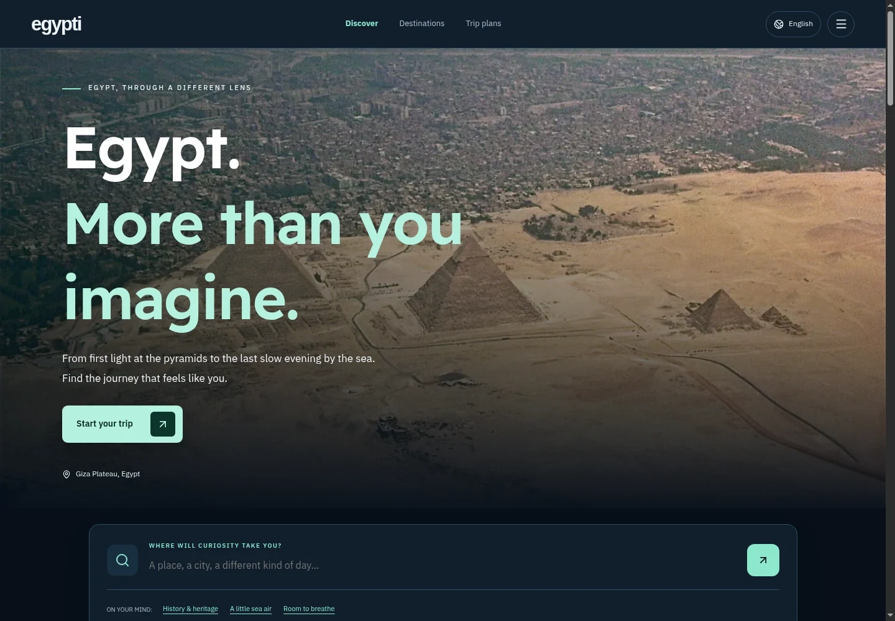
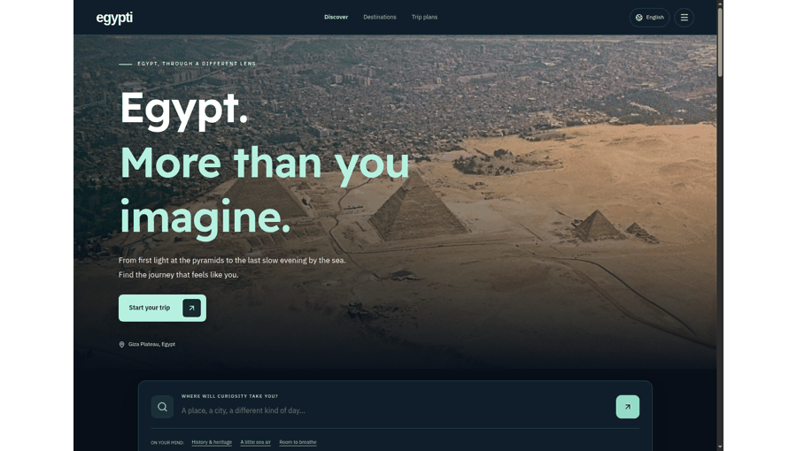
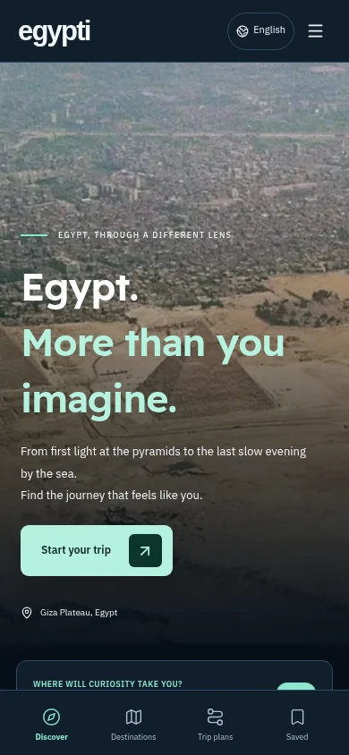

<div align="center">

# egypti

### An independent Egypt guide — Arabic and English

A mobile-first travel companion for domestic travellers and international visitors,
with verified places, honest labels and real photography.

[](https://egypti.pages.dev)
[](https://nextjs.org)
[](https://hono.dev)
[](https://pages.cloudflare.com)

[](https://egypti.pages.dev)

**[Explore Egypt →](https://egypti.pages.dev)**

</div>

---

## Live preview

Captured from the live English edition on 18 November 2026. The short animated tour cycles through home, the destination directory and the Cairo & Giza guide. Screens are from the actual site, not generated mockups.

[](https://egypti.pages.dev/en/)

| Desktop | Mobile |
| --- | --- |
|  |  |

[Browse destinations](https://egypti.pages.dev/en/destinations/) · [Cairo & Giza](https://egypti.pages.dev/en/destinations/cairo/)

## First edition

- **Destination hubs, place and area guides, and flexible itinerary outlines.**
- **Arabic and English content**, explicit locale URLs, RTL/LTR, remembered language choice.
- **Source links and review dates.** Unverified prices or hours are labeled, never invented.
- **Google Maps place-card links.** Broad or changing locations do not get guessed pins.
- **Email/password and Google sign-in**, guest bookmarks, D1-backed synced bookmarks and sign-out.
- **18 hand-tuned themes** with a contrast-checked palette test suite, plus a read-only
  admin dashboard with health checks.

## Architecture

```
Next.js static export (src/app/[lang]/... per-locale prerendered pages)
  └─ /api/* ──► Hono bundled from api/index.ts to out/_worker.js
        ├─ Google OAuth: state + nonce + PKCE S256, verified ID tokens
        ├─ Session tokens hashed in Cloudflare D1
        └─ /api/admin/* guarded by a server-side email allowlist
```

- `_routes.json` restricts Function invocation to `/api/*`; static pages are served directly.
- Admin themes and site themes are saved per device; `tests/themes.test.ts` checks text
  contrast for every theme.

## Local setup

Node 22 or newer is recommended.

```sh
npm ci
npm run build
npm test
npm run test:e2e
npx wrangler pages dev out
```

`npm run test:e2e` uses an installed Chrome at `/usr/bin/google-chrome-stable`. Change the
executable path in `playwright.config.ts` for another environment. The browser tests
exercise the static frontend; API tests use Miniflare and a disposable local D1 database.
The real Google OAuth round trip must also be tested on the deployed origin.

## Deployment

Cloudflare Pages build: `npm ci && npm run build`; output: `out`; production branch: `main`.

Set the D1 binding `DB` and apply `migrations/0001_initial.sql`. Set `APP_ORIGIN` to the
exact production HTTPS origin. Store `GOOGLE_CLIENT_ID`, `GOOGLE_CLIENT_SECRET`, and a
random `AUTH_SECRET` as Cloudflare secrets, never in source control. Register
`${APP_ORIGIN}/api/auth/google/callback` with the Google OAuth client.

Production `ADMIN_EMAILS` is configured as a Pages secret allowlist. Do not duplicate it
under vars; keep existing production secrets when deploying. No allowlist means admin
access is denied.

## Deliberate limits

- No payments, internal ticket checkout, hotel bookings or user reviews.
- Machine translation is not enabled until a provider and any costs are approved. The
  interface never pretends unavailable languages are translated.
- Prices and opening hours are not live inventory. Only explicitly verified ticket data
  is shown; other entries link to official sources.
- First-edition metadata uses `noindex` until editorial launch review.

## Safety and privacy

OAuth uses state, nonce, PKCE S256, Google ID-token signature/audience/issuer
verification, and secure HttpOnly same-site cookies. Session tokens are hashed in D1.
Mutations require a matching Origin and JSON, IDs are validated. No Gmail, Drive,
contacts or advertising-tracker access is used. Full privacy information is available
in both languages in the site.

## Photography and fonts

Photos are real, archival destination images. They do not guarantee present access.
Cropped, resized and recompressed derivatives remain under each image's original license.
Credits and license links are listed on the About page and in `ASSET_CREDITS.md`.

Noto Sans Arabic is licensed under the SIL Open Font License. A subset is bundled for
fast loading; the font license is included in `public/fonts/OFL.txt`.

---

<div align="center">

Made with care by **Mohamed Alhinawi** · [egypti.pages.dev](https://egypti.pages.dev)

</div>
